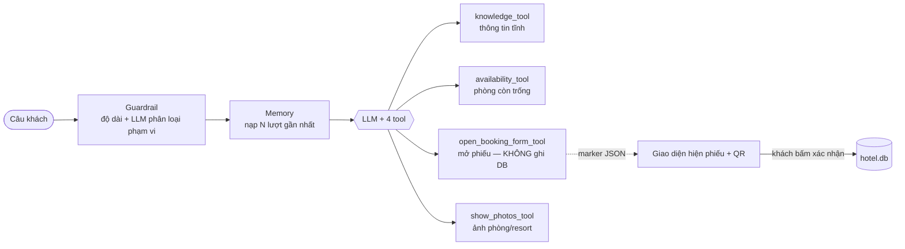
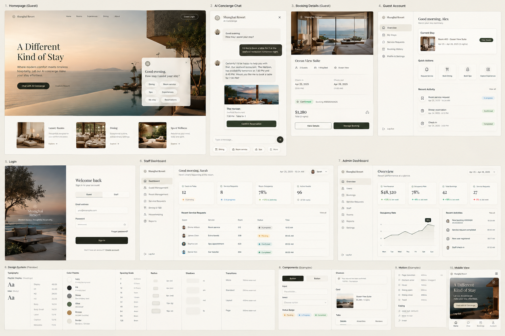

<div align="center">

# 🏨 Khaifrost Resort — Hotel Chatbot

**Lễ tân ảo tiếng Việt: trả lời có căn cứ, nhớ ngữ cảnh, và *làm việc thật* — đặt phòng, gọi dịch vụ.**

[](https://github.com/usermangcut-ai/HotelChatbot/actions/workflows/ci.yml)


**Agent tool-use** · **4 vai trò phân quyền** · **Guardrail 2 lớp** · **LLM không bao giờ tự ghi database**


</div>

---

## Mục lục
- [Tính năng](#-tính-năng)
- [Kiến trúc](#-kiến-trúc)
- [Phân quyền](#-phân-quyền-4-vai-trò)
- [Bắt đầu nhanh](#-bắt-đầu-nhanh)
- [Cấu trúc dự án](#-cấu-trúc-dự-án)
- [Kiểm thử & đánh giá](#-kiểm-thử--đánh-giá)
- [Cấu hình](#%EF%B8%8F-cấu-hình)
- [Ghi chú vận hành](#-ghi-chú-vận-hành)

---

## ✨ Tính năng

| | |
|---|---|
| 💬 **Hỏi–đáp có căn cứ** | Hạng phòng, giá, tiện ích, giờ giấc, nội quy — chỉ trả lời từ dữ liệu thật (`data/knowledge.json`), không suy diễn |
| 🛏️ **Đặt phòng theo khoảng ngày** | Kiểm tra phòng trống chống overbook → sinh phiếu + mã QR (demo) → khách **bấm xác nhận** mới ghi DB → tự cấp tài khoản khách lưu trú (mật khẩu hiện đúng 1 lần) |
| 🍽️ **Đặt dịch vụ nhà hàng / spa** | Chỉ khách đang lưu trú (đã đăng nhập), thao tác trực tiếp trên giao diện |
| 🖼️ **Gửi ảnh đúng lúc** | Chatbot tự quyết định gửi ảnh phòng/resort khi phù hợp ngữ cảnh |
| 🛎️ **Hỗ trợ nhanh cho khách** | Dọn phòng, báo hỏng thiết bị… không cần nhập lại thông tin, xem lịch sử yêu cầu |
| 👩‍💼 **Nhân viên** | Hàng đợi yêu cầu dịch vụ + hỗ trợ phòng, đánh dấu đã xử lý |
| 🛠️ **Quản trị** | Xem / sửa / huỷ đặt phòng và yêu cầu dịch vụ, quản lý tài khoản nhân viên |

---

## 🧭 Kiến trúc

Một cổng duy nhất: **FastAPI** (`api/`) phục vụ cả API lẫn giao diện **React** (`frontend/`) đã build.

### Agent — tool-use, không router cứng



- **LLM tự chọn tool** (kể cả nhiều tool trong 1 lượt) — không có if/else định tuyến câu hỏi.
- **LLM không bao giờ tự ghi cơ sở dữ liệu.** `open_booking_form_tool` chỉ trả marker; DB chỉ được ghi khi **con người bấm xác nhận** trên giao diện.
- **Grounding:** mọi số liệu chỉ lấy từ kết quả tool; thông tin rủi ro cao (số điện thoại, đánh giá…) nhúng thẳng từ `knowledge.json` vào system prompt — một nguồn duy nhất.
- **Guardrail 2 lớp:**
  1. `agent/guardrail.py` chạy **trước** agent: chặn input quá dài, phân loại phạm vi bằng LLM riêng (đúng phạm vi / ngoài phạm vi / dấu hiệu prompt injection), có kèm lịch sử hội thoại để không chặn nhầm câu cụt.
  2. `agent/tools.py` kiểm tra tất định bằng code: loại dịch vụ, hạng phòng, ngày tháng sai bị chặn trước khi mở phiếu.
- **Multi-turn:** lịch sử hội thoại đưa thẳng vào messages, không cần bước viết lại câu hỏi.

<div align="center"></div>

---

## 🔐 Phân quyền 4 vai trò

Đăng nhập bằng session cookie (bảng `sessions` trong `hotel.db`). Mật khẩu hash **bcrypt** (salt riêng, cố ý tính chậm để chống dò hàng loạt).

| Vai trò | Đăng nhập bằng | Vào được |
|---|---|---|
| Khách vãng lai | không cần | Trang chủ, đặt phòng |
| Khách đang lưu trú | Số phòng + mật khẩu (cấp tự động khi thanh toán xong) | Trang tài khoản, đặt dịch vụ |
| Nhân viên | Tên đăng nhập + mật khẩu | Hàng đợi xử lý yêu cầu |
| Quản trị viên | Tên đăng nhập + mật khẩu | Bảng quản trị toàn hệ thống |

Route dịch vụ (`/dich-vu`, `/api/service-requests`) chỉ nhận khách đang lưu trú — vào từ giao diện thì thấy màn chặn, gọi thẳng API nhận `401` / `403`.

---

## 🚀 Bắt đầu nhanh

### Docker (khuyến nghị)
```bash
copy .env.example .env        # điền LLM_BASE_URL / LLM_API_KEY / LLM_MODEL + ADMIN_PASSWORD
mkdir storage                 # thư mục dữ liệu động (container chạy user không phải root)
docker compose up -d --build  # → http://localhost:8000
```
Dữ liệu động (`storage/`) được mount ra ngoài nên build lại / khởi động lại không mất dữ liệu.
> Windows + Git Bash: dùng `docker compose`, không dùng `docker run -v …` trực tiếp (Git Bash tự đổi đường dẫn trong `-v`).

<details>
<summary><b>Chạy thủ công</b></summary>

```bash
python -m venv .venv
.venv\Scripts\pip install -r requirements.txt
copy .env.example .env

cd frontend && npm install && npm run build && cd ..
.venv\Scripts\python -m uvicorn api.main:app --reload
```
Provider LLM cần chuẩn OpenAI `/chat/completions` và **hỗ trợ function-calling**.
Lần khởi động đầu (chưa có nhân viên nào), app tạo admin từ `ADMIN_USERNAME` / `ADMIN_PASSWORD`; để trống mật khẩu thì không tạo.
</details>

Triển khai Railway: [`docs/DEPLOY_RAILWAY.md`](docs/DEPLOY_RAILWAY.md) · Hướng dẫn sử dụng: [`docs/huong-dan-su-dung.md`](docs/huong-dan-su-dung.md)

---

## 📁 Cấu trúc dự án

```
agent/      Lõi: config · memory · trace · knowledge · db (dữ liệu + RBAC) · tools · agent · prompts ·
            photos · guardrail · run · llm_client — dùng chung cho CLI và API, không phụ thuộc web framework
api/        FastAPI: main.py (app + phục vụ frontend tĩnh) · auth.py · ratelimit.py · schemas.py ·
            routes/ (chat, bookings, service_requests, auth, admin, staff, guest) — chỉ bọc agent/* thành HTTP
frontend/   React 19 + Vite + TypeScript + Tailwind: pages (trang chủ, đặt phòng, dịch vụ, đăng nhập,
            quản trị, nhân viên, tài khoản khách), components, AuthContext, api.ts
data/       Dữ liệu TĨNH: knowledge.json · rooms.json (22 phòng vật lý) · images/
storage/    Dữ liệu ĐỘNG (không track git, là volume khi chạy Docker): hotel.db · logs/traces.jsonl
eval/       golden.jsonl (đơn lượt) · golden_multi.jsonl (nhiều lượt) · run_eval.py
tests/      Unit test agent/ và api/ (fake LLM/DB, không gọi mạng)
docs/       Triển khai, hướng dẫn sử dụng, thiết kế giao diện, trạng thái dự án
```

---

## 🧪 Kiểm thử & đánh giá

```bash
.venv\Scripts\python -m pytest            # unit test agent/ + api/, không cần .env
.venv\Scripts\python eval\run_eval.py     # chất lượng trả lời của agent, cần .env
.venv\Scripts\python -m agent.run         # chat qua CLI, không cần frontend
```

Bộ đánh giá: **25 case đơn lượt + 17 hội thoại nhiều lượt**, bao phủ thông tin phòng/resort, giờ giấc & nội quy (kèm câu phủ định dễ nhầm), đặt phòng (đủ thông tin / ngày tương đối / thiếu thông tin), từ chối câu ngoài phạm vi, và chống prompt injection giữa hội thoại.
**CI** (GitHub Actions) chạy test backend + frontend và build thử Docker image ở mỗi push / PR.

---

## ⚙️ Cấu hình

<details>
<summary><b>Biến môi trường</b></summary>

| Biến | Mặc định | Ý nghĩa |
|---|---|---|
| `LLM_BASE_URL`, `LLM_API_KEY`, `LLM_MODEL` | — | Provider LLM (bắt buộc để chat) |
| `STORAGE_DIR` | `./storage` | Thư mục dữ liệu động; trên Docker là `/app/storage` |
| `DB_PATH` | `$STORAGE_DIR/hotel.db` | File SQLite |
| `LOG_PATH` | `$STORAGE_DIR/logs/traces.jsonl` | Trace từng lượt chat |
| `APP_TZ` | `Asia/Ho_Chi_Minh` | Múi giờ nghiệp vụ |
| `ADMIN_USERNAME`, `ADMIN_PASSWORD` | `admin`, trống | Admin tạo lần đầu |
| `COOKIE_SECURE` | `false` | `true` khi chạy sau HTTPS |
| `CHAT_IDLE_MINUTES` | `60` | Phiên chat im lặng quá số phút này thì xoá khỏi RAM |
| `CHAT_MAX_SESSIONS` | `1000` | Trần số phiên chat trong RAM |
| `GUEST_LOGIN_ANYTIME` | `false` | `true` = khách đăng nhập được cả trước ngày nhận phòng (test/demo) |
| `GUARDRAIL_ENABLED` | `true` | Tắt khi cần đo độ trễ |

**Nâng cấp từ bản cũ** (`hotel.db` nằm ở `data/`): dời `data/hotel.db*` sang `storage/`, xoá `data/hotel_view.json`. Lần khởi động sau app tự nâng cấp schema (`PRAGMA user_version`).
</details>

---

## 📝 Ghi chú vận hành

- `storage/hotel.db` là **nguồn dữ liệu thật duy nhất**; schema tạo/nâng cấp tự động bằng migration đánh số (`agent/schema.py`), phòng vật lý seed từ `data/rooms.json`.
- Trace từng lượt chat: `storage/logs/traces.jsonl`, lọc theo `session_id`.
- Hội thoại chat chỉ nằm trong RAM server (F5 vẫn giữ nhờ `sessionStorage`, đóng tab là mất) → chạy **1 instance, 1 worker**; `--reload` khi dev cũng xoá các cuộc chat mỗi lần code đổi.
- **Có chủ đích không làm:** cá nhân hoá qua nhiều phiên, RAG (kho kiến thức đủ nhỏ để nhúng thẳng vào prompt), cổng thanh toán thật (QR là demo), OAuth/SSO.

<div align="center"><sub>Ảnh minh hoạ: xem <a href="data/images/CREDITS.md">data/images/CREDITS.md</a></sub></div>
